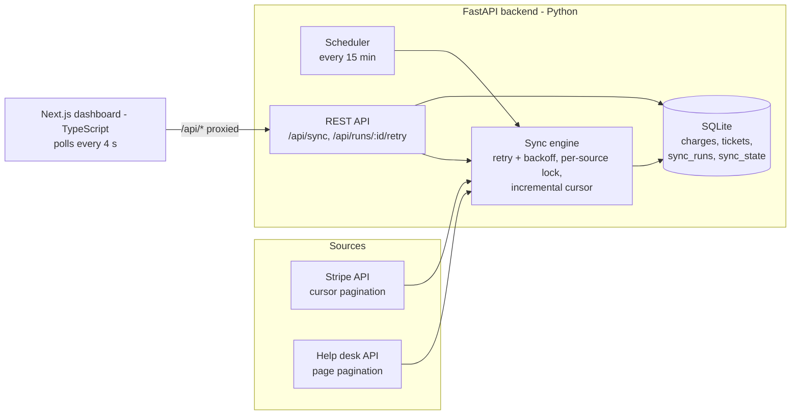

# Ops Sync Dashboard

**Your payments and your support queue in one dashboard, synced on schedule, with every sync run visible and retryable.**

  


## The problem

Small SaaS and e-commerce teams live in two tabs: **Stripe** (who paid, who failed, who refunded) and the **help desk** (who is angry). Nobody connects the two. The customer whose card was declined twice *and* has an urgent ticket open is your biggest churn risk, and they're invisible.

When teams do glue the tools together with scripts or zaps, the glue fails silently. Data goes stale and nobody notices until a report is wrong.

## The solution

A small internal tool, and the seed of a SaaS product:

- **Syncs** Stripe charges and help-desk tickets into one database, on a schedule and on demand
- **Shows** the KPIs that matter: 30-day revenue, failed payments and the money at risk, open and urgent tickets
- **Connects the sources**: an *at-risk customers* list shows everyone with a failed payment **and** an open ticket
- **Makes sync health obvious**: every run is recorded with its status, record count, attempts, duration and error, and has a **Retry** button

## Architecture



The bundled **mock APIs** (`backend/mock_apis`) mimic Stripe and a Zendesk-style help desk, including auth, pagination and a `/__chaos` endpoint for injecting failures. Everything runs offline, and failure handling can be shown live.

## Features

- **Sync now** for all sources or one, plus a **scheduled sync** (in-process scheduler, or `python -m app.cli sync` for cron and Kubernetes CronJobs, which exits 1 on failure)
- **Run history** with status, trigger (manual, scheduled or retry), records, attempts, duration and error message
- **Retry button** on failed runs. A successful retry links back to the run it fixed ("✓ fixed by #5")
- **Source health cards**: healthy, syncing, failing, or stale when the last success is too old
- **KPIs and a revenue chart** (dependency-free SVG) plus **open tickets** sorted by priority
- **At-risk customers**: a cross-source insight neither tool shows by itself
- One-origin setup: Next.js proxies `/api/*` to FastAPI, so there's no CORS setup in production

## Reliability

| Risk | How it's handled |
|---|---|
| API timeouts, 429s, 5xx | Every page request is retried with exponential backoff and jitter. The attempt count is shown per run |
| Bad credentials (401/403) | Fails fast with no pointless retries, and the run shows the exact error |
| Re-running a sync | **Idempotent upserts** by source id. Re-syncing never creates duplicates |
| A partial failure mid-sync | The cursor only advances after a **successful** run, so the next run re-fetches and upserts safely |
| Late-arriving updates | Incremental cursor with a 5-minute overlap window |
| Double-clicking "Sync now" | A **per-source lock**: the second request gets `409`, so there are no racing writers |
| Process crashes mid-run | On startup, runs stuck in `running` are marked failed ("interrupted") and can be retried |
| Silent staleness | The UI flags a source as *Stale* when its last success is over 2 hours old |
| Observability | JSON logs per run (run_id, source, attempts, records, error) |
| Unauthorised triggers | Optional `ADMIN_TOKEN` protects "Sync now" and "Retry" |

## Quick start (no API keys needed)

Requirements: Python 3.10+ and Node 20+.

```bash
cp .env.example .env
python -m venv .venv && source .venv/bin/activate
pip install -r backend/requirements-dev.txt
(cd frontend && npm install)

./scripts/dev.sh                    # mock APIs :9100, API :8000, dashboard :3000
```

Open **http://localhost:3000**. In a second terminal, run the scripted failure-and-recovery demo:

```bash
./scripts/demo.sh                   # flaky API -> retries; API down -> failed run; recovery -> retry
```

Or with Docker: `docker compose up --build`

### Tests

```bash
(cd backend && pytest)              # 11 tests: pagination, idempotency, retries, cursor safety, locks, API
(cd frontend && npm test)           # 14 tests: formatting, health logic, Retry button behaviour
```

### Screenshots

The images in `docs/` were captured headlessly with Playwright (`python scripts/screenshot.py`, with the stack running):

| Failure state | After clicking Retry |
|---|---|
|  |  |

### Connecting real data

1. Create a **restricted Stripe key** with read-only access to Charges. Set `STRIPE_API_BASE=https://api.stripe.com` and `STRIPE_API_KEY=rk_test_...`
2. Point `HELPDESK_API_BASE` and `HELPDESK_API_KEY` at your help desk. The connector follows Zendesk's ticket list shape, and other help desks only need the `normalize()` mapping in `backend/app/connectors/helpdesk.py` changed
3. Remove the `mock-apis` service from `docker-compose.yml`

## Project structure

```
backend/
  app/
    main.py          FastAPI app: summary, runs, sync now, retry, insights
    sync.py          sync engine + scheduler (retries, locks, cursors, crash recovery)
    connectors/      stripe.py, helpdesk.py (pagination + normalisation)
    db.py, retry.py, cli.py, config.py
  mock_apis/         offline Stripe + help-desk APIs with chaos injection
  tests/             pytest
frontend/
  app/page.tsx       dashboard
  components/        KPI cards, source cards, runs table, chart, lists
  lib/               API client, formatting and health logic
  tests/             vitest + Testing Library
scripts/             dev.sh, demo.sh, screenshot.py
docs/                screenshots, demo output
```

## Roadmap (SaaS seed)

Multi-tenant workspaces · OAuth "Connect Stripe" · Slack alert when a sync fails twice · more connectors (Intercom, Freshdesk, HubSpot) · Postgres · usage-based billing on Stripe.

---
Built by **Taha Elkarroumy**: reliable business automations with AI, APIs, Python and TypeScript.
